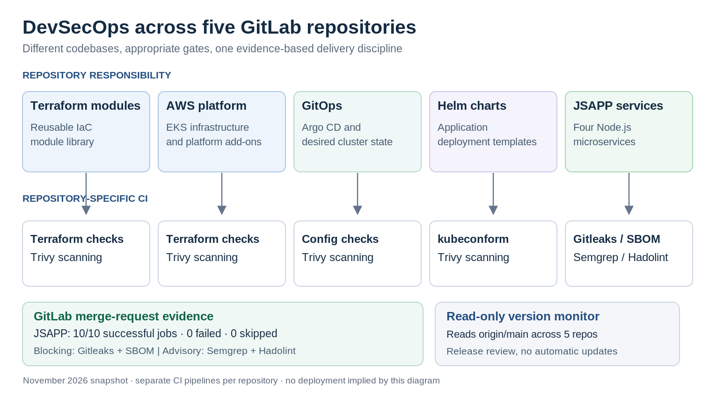

# Building DevSecOps Gates Across Five GitLab Repositories

> A security baseline that preserves existing Terraform, GitOps and semantic-version release responsibilities



## Context

The [JSAPPINF platform](https://github.com/jansoltys9/jsappinf-platform-portfolio) spans five repositories with different responsibilities: reusable Terraform modules, AWS platform infrastructure, Kubernetes GitOps configuration, Helm charts and four Node.js microservices. The existing CI/CD system already supported repository-specific validation and an application release flow. The task was to add **consistent, evidence-based security checks** without turning every repository into an identical pipeline or making CI mutate infrastructure.

The implementation was intentionally compatible with **GitLab Free**, pinned scanner versions and the existing separation between CI execution, release decisions and GitOps reconciliation.

**Evidence boundary:** this case study is based on supplied GitLab merge and pipeline results, local security-scan outputs and the five-repository monitor run of 19 November 2026. The author did not independently re-run a deployed EKS environment or inspect live production security settings for this review. A successful scan job is evidence that the configured job completed, not proof that an entire platform is vulnerability-free.

## Original State

The repositories had different development and delivery concerns:

| Repository | Primary responsibility | Relevant verification domain |
|---|---|---|
| `terraform-modules` | Reusable infrastructure modules | Terraform validation and infrastructure/security analysis |
| `jsappinf-platform` | AWS EKS and platform infrastructure | Terraform validation and IaC/secret analysis |
| `jsappinf-gitops` | Argo CD Applications and desired cluster state | GitOps configuration and security scanning |
| `helmchartsappjs` | Application Helm charts | Chart/Kubernetes schema validation and scanning |
| `JSAPP` | UI, user, product and order microservices | Service tests, secrets, code, Dockerfiles and software inventory |

The challenge was **coverage consistency and maintainability**, not a claim that the repositories had no testing or security controls beforehand. The existing application flow used semantic versions, image builds and a separate GitOps promotion step; those responsibilities were retained.

## Problem or Limitation

There were three practical failure modes to solve:

1. **Different repositories needed different security gates.** A Terraform project cannot use the same meaningful checks as a Node.js service or a Helm chart repository.
2. **A green pipeline could be misleading.** Advisory jobs may fail without failing the whole pipeline; a job's result, `allow_failure` policy and artifacts all need to be evaluated.
3. **Security tools themselves need operational discipline.** Scanner versions drift, developer worktrees can be dirty, Docker Hub pulls can time out, and a generic secret rule can flag a non-authentication value in historical documentation.

A final requirement was to keep the workflow practical: group findings, perform local checks once, apply a reviewed fix, push once and use GitLab as the independent final verifier.

## Decision and Responsibility Model

The baseline was implemented **per repository**, with a common security intent rather than a single copy-pasted job list.

| Layer | Owns | Does not own |
|---|---|---|
| Repository CI | Validation, pinned scanner execution, test results and artifacts | Unreviewed application releases or direct cluster changes |
| Developer preflight | Faster local diagnosis, classification and batched remediation | Replacing the independent GitLab merge gate |
| GitLab merge request | Reviewable code change, recorded job outcome and approval/merge workflow | Asserting that a passed job has zero findings without reading its report |
| Semantic-version release flow | Image/version lifecycle after applicable release conditions | Implicit GitOps changes from a security-only merge request |
| GitOps / platform runtime | Desired-state reconciliation and runtime operations | Acting as a secret-scanning mechanism for Git history |
| Local version monitor | Read-only inspection of `origin/main` and upstream release candidates | Automatic dependency updates, merges, deployments or a scheduled service |

## Implementation

### Repository-specific security baseline

The infrastructure repositories retained Terraform-oriented validation and Trivy-based checks. The GitOps and Helm repositories retained configuration-oriented checks, including `kubeconform` in the chart workflow. The application repository added a dedicated security include:

```yaml
include:
  - local: devsecops/portfolio-security.yml
```

The JSAPP merge-request baseline included the following jobs:

| Job | Role | Merge-request failure policy |
|---|---|---|
| `devsecops:gitleaks` | Git history secret detection | Blocking |
| `devsecops:semgrep` | Static source-code analysis | Advisory during initial rollout |
| `devsecops:hadolint` | Dockerfile linting | Advisory during initial rollout |
| `devsecops:sbom` | CycloneDX software bill of materials | Blocking |

The security jobs were added alongside—not instead of—service merge-request checks, DB lifecycle validation and release-helper validation. The pipeline used explicitly pinned tool images rather than floating `latest` tags.

**Important distinction:** generating a CycloneDX SBOM records a software inventory; by itself it does not prove that the listed components have no vulnerabilities. Similarly, an advisory Semgrep or Hadolint job can complete successfully while still producing reviewable warnings.

### Challenge: a historical `Idempotency-Key` matched a generic secret rule

The first JSAPP Gitleaks run failed on **one finding in a scan of 158 commits**. The report identified `generic-api-key` at `docs/order-correctness.md`, line 13, in historical commit `088bda2616`.

A targeted inspection showed that the flagged line represented the HTTP `Idempotency-Key` header in a `POST /orders` example. That header identifies a request for duplicate-operation protection; it is **not, by its role, an authentication bearer token or a GitLab repository access token**. References to idempotency were found in the order-service implementation and tests.

The scanner had redacted the match, so the original value's provenance and validity were not independently established. The response therefore avoided both extremes: declaring a confirmed credential leak and blindly disabling secret scanning.

The reviewed remediation was to:

1. Replace the current documentation value with the visibly illustrative `Idempotency-Key: order-create-example-001`.
2. Preserve the historical commit rather than rewriting a shared repository history.
3. Add **one exact Gitleaks fingerprint** to `.gitleaksignore` for the reviewed historical match—not an exception for the entire file, rule or repository.
4. Verify Gitleaks against **Git history and the working directory** locally, then verify the blocking job again in GitLab CI.

This is a narrowly documented false-positive handling decision for a non-authentication header. If separate evidence ever establishes that the historical value was a real secret, the ignore entry would not substitute for appropriate credential revocation and incident handling.

### Challenge: local scanner availability did not equal scan success

A local Gitleaks Docker image was missing, and the Docker Hub pull repeatedly timed out. The local preflight correctly reported **`BLOCKED`**, not `PASS`. A verified native Windows Gitleaks `8.28.0` binary was then used to inspect the same Git history, without modifying the original service worktree.

The broader batch diagnostic reported local Semgrep, Hadolint and SBOM runs as blocked when their images were unavailable. Instead of retrying downloads indefinitely, the team used the actual GitLab pipeline outcomes as the independent CI evidence. Four Node.js `npm audit` checks were also run together against tracked lockfiles; they reported **zero vulnerabilities at that point in time**.

### Central tool-version monitoring

A separate, read-only local monitor was built to inspect security/validation tool pins across all five repositories. Crucially, it reads **`refs/remotes/origin/main`** instead of the currently checked-out branch, so dirty development worktrees do not distort what is deployed as the repository baseline.

The monitor inspects nested CI files and compares pinned versions with upstream release information. On 19 November 2026 it discovered CI definitions in all five repositories and returned **six newer-release review candidates**, including Terraform, Trivy, Hadolint, Semgrep and Gitleaks. These were upgrade candidates, **not confirmed vulnerabilities**.

This monitor was run locally. At the time of this case study it had **no automatically scheduled execution or automatic version-bump/push behavior**.

## Validation

The five baseline merge requests were merged into their respective default branches. The final JSAPP security merge request was **!10**, incorporating source commit `5a22622b` and merge commit `8f57bc3` on 19 November 2026.

The exported GitLab job metadata for **pipeline `#3088559122`** established the following for that commit:

| Evidence | Observed result |
|---|---|
| Pipeline | `success`, merge-request event |
| Individual job statuses | **10 successful, 0 failed, 0 skipped** |
| Gitleaks | `success`, `allow_failure: false` |
| Semgrep | `success`, `allow_failure: true` |
| Hadolint | `success`, `allow_failure: true` |
| CycloneDX SBOM | `success`, `allow_failure: false`; artifact archive present |
| Four microservice merge-request validation jobs | All successful |
| DB lifecycle and release helpers | Both successful |
| Local `npm audit` (four services) | All passed with zero reported vulnerabilities in that snapshot |
| Local Gitleaks after remediation | Git history and working-directory scans passed |

The SBOM job exposed an artifact archive of approximately 36 KB; this case study does not claim to have independently validated the contents of its CycloneDX document. The JSON job export also did not contain complete Semgrep/Hadolint findings. **`success` describes job execution, not an independently verified zero-warning report.**

## Result

The baseline reached all five repositories without requiring an AWS or Kubernetes operation for the security-only change. In JSAPP, the historical Gitleaks blocking issue was handled through a narrow, reviewable exception; the completed MR pipeline had ten successful jobs; and the release/Helm/GitOps responsibilities remained separate.

The version monitor added visibility into scanner drift without automatically changing infrastructure or triggering new pipelines.

## Current Status and Limits

- **Implemented:** five-repository security/validation baselines, JSAPP blocking Gitleaks and SBOM jobs, advisory Semgrep/Hadolint, read-only version monitoring.
- **Verified:** merged baseline changes; final JSAPP 10/10-success MR pipeline; four local npm audit snapshots; local Gitleaks history and directory checks.
- **Not claimed:** a production penetration test, live runtime validation, DAST coverage, zero outstanding IaC findings, zero Semgrep warnings, or zero vulnerabilities in future dependency versions.
- **Follow-up:** review advisory and infrastructure findings, schedule the monitor if useful, and assess scanner upgrades separately from release work.

## Technologies

**GitLab CI/CD, Git, Terraform, Trivy, Gitleaks, Semgrep CE, Hadolint, CycloneDX SBOM, Node.js/npm, Docker, Helm, kubeconform, Argo CD and AWS EKS** (the latter as platform context, not an environment exercised in this security-only change).

## Key Lessons

- **A green pipeline is a starting point, not a security conclusion.** Inspect individual job status, failure policy and artifacts.
- **Blocking and advisory checks have different jobs.** Block on well-understood critical gates; review advisory findings without hiding them.
- **A detection is not automatically an incident.** Classify the actual data and its purpose before suppressing a specific false positive—or revoking unrelated credentials.
- **`BLOCKED` must never be reported as `PASS`.** A scanner that could not start did not validate the code.
- **Read the version baseline from `origin/main`, not a dirty worktree.** Monitoring should reflect merged repository configuration.
- **Security work should respect delivery boundaries.** CI validates; release approvals, image promotion and GitOps remain separately controlled.
